# Sprite Glossary

Every raw ID below shows the graphic exactly as the game renders it - cropped directly from a real savestate screenshot, not decoded from ROM graphics data (see `tools/sprite_atlas.py` for why: the room's raw terrain byte isn't the background tilemap ID directly, so there's a translation step that hasn't been reverse-engineered yet; scraping the rendered pixels sidesteps that gap).

Auto-generated by `tools/sprite_atlas.py` by scanning every savestate under `scratch/states/`. Re-run it after adding new savestates (e.g. from `tools/autowalker.py`) to pick up anything newly captured - it will not overwrite entries for IDs it already has an image for from a previous run unless you delete the file first.

**Caveat:** a few crops may show a blank/dark square instead of real art. The scanner reads the logical room data in WRAM directly, which always holds the real byte - but the *visual* tilemap only draws tiles the darkness/fog-of-war system has actually revealed so far (see [Dungeon Mechanics](Dungeon-Mechanics) "Darkness / torch visibility"). If the automated scan happened to grab a savestate before the player visually reached that spot, the crop shows undrawn/dark fog rather than the tile's real graphic. Re-running against a savestate where that cell has actually been seen fixes it.

## Map / terrain tiles

**"BG tiles" column:** the actual hardware background-tilemap tile IDs underneath this cell (2x2 real 8x8 tiles per logical 16x16 cell), read directly from `$9800` - i.e. ground truth for how many *distinct* tiles are actually stacked/arranged here, independent of the flattened screenshot crop. This is **not** the room's raw terrain byte translated to graphics (that mapping is still unsolved, see the caveat above) - it's simply what's physically in VRAM.

| Image | Raw ID | BG tiles | Identified as | Confidence | Source |
|---|---|---|---|---|---|
|  | `$00` | 1 unique ($23,$23,$23,$23, $8800) | Open floor | Confirmed | `scratch/states/after_fight.state` (0,3) |
| 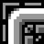 | `$01` | 4 unique ($01,$03,$02,$04, $8800) | Unknown | Unidentified | `scratch/states/after_fight.state` (0,0) |
|  | `$02` | 4 unique ($07,$09,$08,$0a, $8800) | Unknown | Unidentified | `scratch/states/after_fight.state` (0,2) |
|  | `$03` | 4 unique ($0f,$11,$10,$12, $8800) | Unknown | Unidentified | `scratch/states/after_fight.state` (7,0) |
| 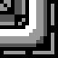 | `$04` | 4 unique ($13,$0a,$12,$14, $8800) | Unknown | Unidentified | `scratch/states/after_fight.state` (7,2) |
|  | `$05` | 3 unique ($03,$06,$05,$05, $8800) | Unknown | Unidentified | `scratch/states/after_fight.state` (0,1) |
| 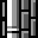 | `$06` | 3 unique ($02,$0c,$0b,$0c, $8800) | Wall (border) | Confirmed | `scratch/states/after_fight.state` (1,0) |
| 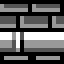 | `$07` | 3 unique ($15,$15,$16,$12, $8800) | Wall (border) | Confirmed | `scratch/states/after_fight.state` (6,3) |
|  | `$08` | 3 unique ($0d,$0a,$0d,$0e, $8800) | Wall (border) / Stairs-down trigger class | Confirmed (class, not this exact byte) | `scratch/states/after_fight.state` (1,9) |
|  | `$09` | 4 unique ($1f,$21,$20,$22, $8800) | Wall (border) - but see the collision caveat | Confirmed as common, exact collision rule open | `scratch/states/after_fight.state` (1,1) |
|  | `$0a` | 4 unique ($19,$0c,$05,$1a, $8800) | Unknown | Unidentified | `scratch/states/after_fight.state` (1,7) |
| 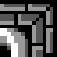 | `$0b` | 4 unique ($15,$18,$17,$0c, $8800) | Unknown | Unidentified | `scratch/states/after_fight.state` (3,7) |
| 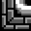 | `$0c` | 4 unique ($0d,$1c,$1b,$05, $8800) | Unknown | Unidentified | `scratch/states/after_fight.state` (1,2) |
| 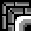 | `$0d` | 4 unique ($1d,$15,$0d,$1e, $8800) | Unknown | Unidentified | `scratch/states/after_fight.state` (3,6) |
| 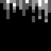 | `$0e` | 3 unique ($46,$47,$24,$24, $8800) | Unknown | Unidentified | `scratch/states/save_007.state` (3,2) |
| 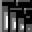 | `$10` | 4 unique ($25,$27,$26,$28, $8800) | Stairs down | Confirmed live | `scratch/states/after_fight.state` (2,5) |
|  | `$11` | 4 unique ($29,$2b,$2a,$2c, $8800) | Harmless floor variant (near stairs) | Confirmed walkable, no effect | `scratch/states/autowalker/terrain_id_11_0036.state` (3,4) |
|  | `$12` | 1 unique ($00,$00,$00,$00, $8800) | Unknown | Unidentified | `scratch/states/floor2.state` (0,3) |
|  | `$13` | 1 unique ($00,$00,$00,$00, $8800) | Unknown | Unidentified | `scratch/states/floor2.state` (1,3) |
|  | `$14` | 1 unique ($00,$00,$00,$00, $8800) | Unknown | Unidentified | `scratch/states/floor2.state` (7,3) |
|  | `$15` | 4 unique ($37,$39,$38,$3a, $8800) | Lava field (same texture as $1b) | Plausible, untested individually | `scratch/states/autowalker/terrain_id_15_0030.state` (2,3) |
|  | `$16` | 4 unique ($33,$35,$34,$36, $8800) | Candidate Bridge | Unconfirmed - unreachable without crossing lava first | `scratch/states/autowalker/terrain_id_15_0030.state` (3,4) |
| 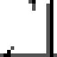 | `$17` | 4 unique ($3b,$3d,$3c,$3e, $8800) | Candidate Bridge | Unconfirmed - unreachable without crossing lava first | `scratch/states/autowalker/terrain_id_15_0030.state` (3,3) |
| 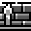 | `$18` | 4 unique ($31,$03,$32,$05, $8800) | Pillar cap (decoration) | Unconfirmed walkability | `scratch/states/save_001.state` (1,2) |
| 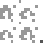 | `$19` | 2 unique ($40,$41,$41,$40, $8800) | Lava field (same texture as $1b) | Plausible, untested individually | `scratch/states/autowalker/terrain_id_15_0030.state` (3,2) |
|  | `$1b` | 3 unique ($3f,$3f,$41,$40, $8800) | Lava | Confirmed live (movement test: instant HP wipe) | `scratch/states/autowalker/terrain_id_15_0030.state` (2,2) |
|  | `$1e` | 1 unique ($24,$24,$24,$24, $8800) | Pillar body (decoration) | Unconfirmed walkability | `scratch/states/autowalker/terrain_id_0e_0018.state` (2,1) |
|  | `$1f` | 4 unique ($1f,$21,$20,$22, $8800) | Unidentified | Open | `scratch/states/save_004.state` (6,3) |
|  | `$20` | 4 unique ($3d,$3f,$3e,$40, $8800) | Unidentified | Open - test inconclusive, see Open Questions | `scratch/states/save_001.state` (2,6) |
| 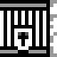 | `$22` | 4 unique ($48,$4a,$49,$4b, $8800) | Fairy Cage | Confirmed live (visual match + Fairy-quest HUD) | `scratch/states/autowalker/terrain_id_22_0026.state` (5,2) |
|  | `$23` | 1 unique ($36,$36,$36,$36, $8800) | Unidentified - sits behind an unexplained movement block | Open | `scratch/states/autowalker/terrain_id_23_0028.state` (2,6) |
|  | `$24` | 4 unique ($56,$58,$57,$59, $8800) | Harmless floor variant (room border) | Confirmed walkable, no effect | `scratch/states/autowalker/terrain_id_24_0037.state` (7,5) |

## Items

Item/chest floor icons are background tiles too (the `$d500` overlay system swaps tilemap entries, see [Dungeon Mechanics](Dungeon-Mechanics)), so the same BG-tile ground truth applies here as for terrain above.

| Image | Type ID | BG tiles | Identified as | Confidence | Source |
|---|---|---|---|---|---|
|  | `$03` | 4 unique ($60,$62,$61,$63, $8800) | Fire (Faiyaa) | Confirmed | `scratch/states/save_005.state` (1,7) |
| 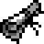 | `$05` | 4 unique ($64,$66,$65,$67, $8800) | Scan state 8 (possibly Ganseki) | Candidate: Ganseki | `scratch/states/save_006.state` (3,5) |
|  | `$07` | 4 unique ($60,$62,$61,$63, $8800) | Orb | Confirmed | `scratch/states/save_001.state` (2,2) |
|  | `$10` | 1 unique ($00,$00,$00,$00, $8800) | Unknown | Unidentified | `scratch/states/floor2.state` (6,4) |
|  | `$12` | 4 unique ($60,$62,$61,$63, $8800) | +1 Max HP (HP no Moto) | Confirmed | `scratch/states/save_009.state` (5,7) |

## Monsters

Animated (2-frame GIF, 16 ticks apart) where the blink-toggle struct field (offset `$04`/`$05`, see [Monster System](Monster-System)) actually changes the sprite in that window; falls back to a static PNG otherwise. **"OAM sprites" column:** the exact hardware sprite count and VRAM tile ID/attribute for each one composing frame 1 - read directly from OAM, not inferred from pixels, so it's unambiguous whether one, two, or more sprites are stacked here.

| Image | Type | Class | OAM sprites (frame 1) | Identified as | Confidence | Source |
|---|---|---|---|---|---|---|
| 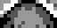 | `$01` | `4` | 2 sprite(s): $ba/attr $20; $b8/attr $20 | Unknown | Unidentified | `scratch/states/autowalker/terrain_id_0e_0018.state` |
| 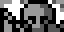 | `$01` | `5` | 2 sprite(s): $b4/attr $00; $b6/attr $00 | Unknown | Unidentified | `scratch/states/save_007.state` |
| 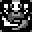 | `$01` | `6` | 4 sprite(s): $2c/attr $40; $2c/attr $60; $b0/attr $00; $b2/attr $00 | Crab | Confirmed | `scratch/states/after_fight.state` |
|  | `$01` | `19` | 2 sprite(s): $b2/attr $20; $b0/attr $20 | Unknown | Unidentified | `scratch/states/save_003.state` |
| 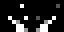 | `$01` | `22` | 2 sprite(s): $8c/attr $10; $8c/attr $30 | Unknown | Unidentified | `scratch/states/save_007.state` |
| 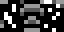 | `$03` | `3` | 2 sprite(s): $f2/attr $20; $f0/attr $20 | Tarantula | Confirmed | `scratch/states/save_004.state` |
| 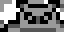 | `$03` | `18` | 2 sprite(s): $b0/attr $00; $b2/attr $00 | Unknown | Unidentified | `scratch/states/save_009.state` |
|  | `$03` | `19` | 2 sprite(s): $b2/attr $20; $b0/attr $20 | Unknown | Unidentified | `scratch/states/save_004.state` |

## Menu sprites, fonts, misc

Hand-curated full-screen captures (not auto-scanned - these live in specific `$c125` UI states, not the dungeon tile grid or monster array). Add more rows to `MISC_ENTRIES` in `tools/sprite_atlas.py` and drop the matching PNG into `wiki/assets/sprites/misc/` as more screens get identified; no dedicated font glyph table or standalone menu-icon crops exist yet.

| Image | State | Description | Confidence |
|---|---|---|---|
| 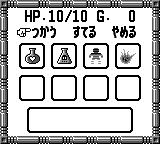 | `$c125=2` | Item-use menu (use/toss/cancel) | Confirmed |
| 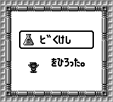 | `$c125=5` | Item-pickup confirmation popup | Confirmed |
| 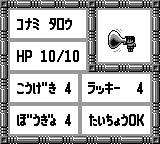 | `$c125=14` | Camp stats screen (Start button) | Confirmed |

## Unknown / not yet categorized

13 terrain ID(s) and 1 item ID(s) above have no name yet (shown as "Unknown" in their table) - see [Open Questions](Open-Questions) for what's needed to identify them.
